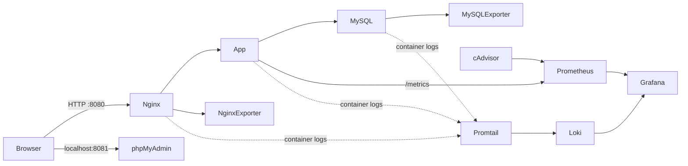

# Đề 7 — Hệ thống Blog / CMS

Mẫu triển khai blog/CMS bằng Docker Compose: Node.js, MySQL, phpMyAdmin, Nginx reverse proxy, Prometheus, Grafana, cAdvisor, Loki và Promtail.

> Trước khi nộp bài: tạo `.env` với mật khẩu riêng, chạy thử toàn bộ hệ thống, chụp ảnh minh chứng thật và đẩy mã nguồn lên repository GitHub mang mã số sinh viên. Không đưa `.env`, mật khẩu hoặc dữ liệu nhạy cảm lên GitHub.

## Kiến trúc



| Dịch vụ | Truy cập từ máy host | Chức năng |
|---|---:|---|
| Blog/CMS qua Nginx | `http://localhost:8080` | Xem bài viết, đăng nhập và quản trị |
| phpMyAdmin | `http://localhost:8081` | Quản lý MySQL; chỉ bind vào loopback |
| Grafana | `http://localhost:3000` | Dashboard container, web, MySQL và Loki |
| Prometheus | `http://localhost:9090` | Targets và truy vấn PromQL |
| MySQL, Loki, exporters | Không publish port | Chỉ truy cập trong các Docker network cần thiết |

Các cổng có thể đổi trong `.env`. Nếu máy đã dùng cổng mặc định, hãy chọn cổng khác trước khi khởi động.

## Yêu cầu

- Docker Desktop đang chạy (bao gồm Docker Compose v2).
- Một máy Windows/macOS/Linux có thể chạy Docker.
- Mạng Internet ở lần build đầu tiên để tải image và thư viện npm.

## Khởi chạy trên Windows PowerShell

Tại thư mục dự án:

```powershell
Copy-Item .env.example .env
notepad .env
```

Thay tất cả giá trị `REPLACE_...` trong `.env` bằng các mật khẩu ngẫu nhiên, khác nhau. Mỗi mật khẩu nên dài tối thiểu 20 ký tự; `ADMIN_PASSWORD` tối thiểu 12 ký tự; `SESSION_SECRET` ít nhất 32 byte. `MYSQL_EXPORTER_PASSWORD` chỉ dùng chữ cái, chữ số, `_` và `-`.

Có thể tạo chuỗi ngẫu nhiên trong PowerShell bằng:

```powershell
[Convert]::ToBase64String([Security.Cryptography.RandomNumberGenerator]::GetBytes(32))
```

Sinh một chuỗi riêng cho từng biến mật khẩu/secret, rồi dán vào `.env`. Không dùng cùng một mật khẩu cho root MySQL, CMS, exporter và Grafana.

Khởi động toàn bộ stack:

```powershell
docker compose up --build -d
docker compose ps
```

Chờ các dịch vụ khởi động/healthcheck, sau đó mở các địa chỉ trong bảng trên. Đăng nhập CMS bằng `ADMIN_USERNAME` và `ADMIN_PASSWORD` trong `.env`. Tài khoản admin được tạo ở lần khởi tạo database đầu tiên.

## Dùng thử CMS

1. Mở `http://localhost:8080`; bài mẫu được tạo tự động khi database khởi tạo. Người mới có thể chọn **Tạo tài khoản** ở trang chủ; đăng ký công khai tạo tài khoản biên tập viên và chuyển về trang chính trong trạng thái đã đăng nhập.
2. Trang đăng nhập `http://localhost:8080/login` chỉ có chức năng đăng nhập và quên mật khẩu, không hiện nút đăng ký.
3. Sau đăng nhập, chọn biểu tượng tài khoản ở góc trên để mở **Hồ sơ cá nhân** hoặc **Đăng xuất**. Hồ sơ cho phép đổi ảnh JPEG, PNG hoặc WebP tối đa 2 MB, cập nhật email và ngày sinh; email là địa chỉ nhận mã khôi phục. Ảnh được lưu trong MySQL. Trong trang hồ sơ có phần đổi mật khẩu; cần nhập mật khẩu hiện tại.
4. Trong trang quản trị, biên tập viên tạo bài viết, lưu bản nháp hoặc xuất bản; admin có thể thêm/xóa danh mục và xem tài khoản thành viên.
5. Để khôi phục, nhập tên đăng nhập hoặc email đã đăng ký tại **Quên mật khẩu?**. Mã 6 chữ số được gửi tới email gắn với tài khoản, có hiệu lực 10 phút và tối đa 5 lần nhập mã.
6. Trong phpMyAdmin, đăng nhập bằng `blog_app` và `DB_PASSWORD` để xem database `blog`. Tài khoản ứng dụng không dùng quyền root.

Khi đăng ký, đổi mật khẩu hoặc đặt lại mật khẩu, thanh độ mạnh tăng 25% cho mỗi tiêu chí: chữ hoa, ít nhất 12 ký tự, chữ số và ký tự đặc biệt. Cả bốn tiêu chí là bắt buộc để hoàn tất. Nhấn biểu tượng con mắt trong ô mật khẩu để hiện/ẩn nội dung đang nhập.

### Gmail SMTP cho khôi phục mật khẩu

1. Bật xác minh 2 bước cho tài khoản Google, sau đó tạo **App Password** trong phần bảo mật tài khoản Google. Không dùng mật khẩu đăng nhập Gmail thường.
2. Điền vào `.env`: `SMTP_USER` là Gmail gửi thư; `SMTP_PASS` là Google App Password (bỏ khoảng trắng); `MAIL_FROM` thường đặt giống `SMTP_USER`. Mặc định dùng `smtp.gmail.com`, cổng `465`, TLS bật.
3. Không gửi App Password qua chat, không chụp/commit `.env`. Nếu Gmail App Password chưa cấu hình, trang khôi phục sẽ báo rõ SMTP chưa sẵn sàng; các chức năng đăng nhập, đăng ký và hồ sơ vẫn hoạt động.
4. Lưu `.env` rồi khởi động lại app để nhận cấu hình: `docker compose up -d --force-recreate app`.

## Giám sát

- Grafana tự cấu hình sẵn hai datasource Prometheus và Loki, cùng dashboard **Blog CMS - Tong quan**.
- Dashboard hiển thị request rate, CPU/bộ nhớ container, trạng thái MySQL/Nginx exporter và trạng thái các Prometheus targets.
- Prometheus scrape ứng dụng, nginx-prometheus-exporter, mysqld-exporter và cAdvisor mỗi 15 giây.
- Nếu dashboard chưa có dữ liệu, kiểm tra `http://localhost:9090/targets`, trạng thái containers và logs trước.

Truy vấn PromQL tham khảo:

```promql
sum by (status) (rate(http_requests_total[5m]))
sum(rate(container_cpu_usage_seconds_total{image!=""}[5m]))
mysql_up
up
```

## Log tập trung và LogQL

Promtail đọc log Docker, thêm nhãn `container` và `service`, sau đó gửi đến Loki. Trong Grafana, mở **Explore**, chọn datasource **Loki** và chạy:

```logql
{service="app"}
{service="nginx"} |= "GET"
{service="app"} | json | level="error"
```

Truy vấn thứ ba dùng được với các log ứng dụng dạng JSON; nếu log hiện không có trường `level="error"`, tạo lỗi thử nghiệm an toàn hoặc bỏ bộ lọc để xem JSON:

```logql
{service="app"} | json
```

Promtail cần đọc Docker socket để phát hiện containers. Socket được mount read-only ở cấp filesystem, nhưng Docker API qua socket vẫn là một quyền nhạy cảm; chỉ chạy trên máy demo đáng tin cậy và không công khai socket/Promtail ra Internet.

## Hardening đã áp dụng

- Ứng dụng chạy bằng user không-root; filesystem ứng dụng read-only, bỏ Linux capabilities và dùng `no-new-privileges`.
- Nginx không chạy worker với quyền root, chỉ thêm `NET_BIND_SERVICE` để lắng nghe cổng 80.
- Phân tách `edge`, `app_net`, `data` và `monitoring`; MySQL, Loki và các exporter không publish cổng ra host.
- phpMyAdmin, Grafana và Prometheus chỉ bind vào `127.0.0.1`; không expose các công cụ quản trị ra mạng LAN.
- Dùng mật khẩu riêng qua `.env`, MySQL exporter có tài khoản chỉ đọc metrics; tài khoản CMS không đăng nhập bằng MySQL root.
- Nginx đặt CSP, `X-Content-Type-Options`, `X-Frame-Options`, `Referrer-Policy`, `Permissions-Policy` và giới hạn kích thước request.
- CMS dùng truy vấn tham số hóa, bcrypt cho password, cookie `HttpOnly`/`SameSite=Strict`, token CSRF cho thao tác POST quản trị.
- Log Docker được giới hạn kích thước và số file.

Stack mẫu dùng HTTP trên mạng máy cá nhân/lab. Security headers không mã hóa lưu lượng. Nếu demo qua mạng công cộng, hãy bổ sung TLS hợp lệ ở reverse proxy, đặt `COOKIE_SECURE=true`, giới hạn firewall và không mở phpMyAdmin/Grafana/Prometheus ra Internet. cAdvisor và Promtail cần quyền đọc tài nguyên host/Docker để thực hiện chức năng giám sát/log; đây là ngoại lệ cần nêu trong báo cáo.

## Vận hành

```powershell
docker compose logs -f app
docker compose logs -f loki promtail
docker compose restart app
docker compose down
```

`docker compose down` giữ lại volumes. Chỉ xóa dữ liệu khi thực sự muốn reset demo:

```powershell
docker compose down -v
```

Lệnh trên xóa database, dữ liệu Grafana/Prometheus/Loki và vị trí đọc log đã lưu.

## GitHub và ba mốc commit

Tạo repository riêng trong tài khoản GitHub của sinh viên, đặt tên theo mã số sinh viên và giữ repository ở chế độ private nếu có secret/dữ liệu cá nhân. Không gửi mật khẩu/token GitHub cho người khác. `.gitignore` đã loại `.env`.

Để lịch sử commit thể hiện đúng ba mốc của đề bài, tạo repository trước khi bắt đầu hoặc staging các phần theo từng mốc:

1. **Commit 1 — `feat: deploy blog cms behind nginx`**: ứng dụng, MySQL/phpMyAdmin, Nginx, Docker Compose cơ sở và README.
2. **Commit 2 — `feat: add prometheus and grafana monitoring`**: Prometheus, Grafana, exporters, dashboard và cấu hình scrape.
3. **Commit 3 — `feat: add loki promtail and hardening`**: Loki/Promtail, hardening, báo cáo và hướng dẫn LogQL.

Trong trường hợp nhận bộ mã nguồn hoàn chỉnh cùng lúc, không nên tạo ba commit giả bằng cách chỉ đổi nội dung commit message. Có thể trình bày ba mốc bằng ba nhánh/PR hoặc tạo các commit theo đúng tiến trình triển khai thực tế. Cấu hình GitHub, tên tài khoản và push cần được thực hiện bởi sinh viên trên tài khoản của mình.

## Báo cáo và minh chứng

Mở `report/bao-cao.md`, điền các trường sinh viên/trường/lớp, xuất thành Word/PDF theo mẫu của trường, giữ ngắt trang và bổ sung ảnh chụp màn hình thật. Các ảnh cần có: blog, CMS sau đăng nhập, phpMyAdmin, response header Nginx, Grafana dashboard, Prometheus targets, truy vấn LogQL, Docker networks và cấu hình non-root. Không nộp ảnh placeholder.

## Khắc phục sự cố

- **Port đã được sử dụng:** đổi `WEB_PORT`, `PMA_PORT`, `GRAFANA_PORT` hoặc `PROMETHEUS_PORT` trong `.env`, rồi chạy `docker compose up -d`.
- **App chưa healthy:** chạy `docker compose logs app db`; kiểm tra password trong `.env` và healthcheck MySQL.
- **Đổi mật khẩu nhưng app vẫn dùng thông tin cũ:** cập nhật `.env` rồi chạy `docker compose up -d --force-recreate app`; nếu đổi root/exporter sau khi volume MySQL đã khởi tạo, cần cập nhật user trong DB tương ứng.
- **Quên mật khẩu admin CMS:** đặt `ADMIN_PASSWORD` trong `.env` và tạo lại/reset hash qua quản trị database; biến môi trường chỉ tạo admin trong lần khởi tạo đầu, không tự ghi đè mật khẩu tài khoản hiện hữu.
- **Metrics/log chưa xuất hiện:** kiểm tra Prometheus targets, `docker compose logs promtail loki`, kết nối các network và chờ ít nhất một chu kỳ scrape.
